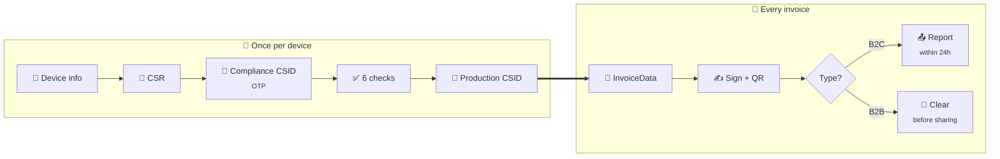

<div align="center">

# 🧾 Laravel ZATCA

### Saudi Arabia's Fatoora e-invoicing, Phase 1 & Phase 2, for Laravel

Onboard a device, sign the invoice and report or clear it, in a few lines of Laravel.

<br>

[](https://www.php.net)
[](https://laravel.com)
[](https://zatca.gov.sa)
[](#-testing)
[](LICENSE)

<br>

**[✨ Features](#-features)** •
**[📦 Installation](#-installation)** •
**[🔐 Onboarding](#-onboarding)** •
**[🧾 Invoices](#-issuing-invoices)** •
**[⚙️ Artisan](#️-artisan-commands)** •
**[🚀 Production](#-going-to-production)**

</div>

<br>

```php
Zatca::onboard($device);                                   // 🔐 one time per device
$document = Zatca::issueAndSubmit($device, $invoice);      // 🧾 sign + report / clear
$document->status;                                         // ✅ REPORTED / CLEARED
```

<br>

## ✨ Features

<table>
<tr>
<td width="50%" valign="top">

### 🔐 Onboarding
- secp256k1 key and **CSR** with the ZATCA extensions
- **Compliance CSID** with the Fatoora OTP
- All **6 compliance checks** run automatically
- **Production CSID** issued
- 🔄 **Certificate renewal** without breaking the chain

</td>
<td width="50%" valign="top">

### 🧾 Invoicing
- **Standard (B2B)** cleared, **Simplified (B2C)** reported
- Invoice, **credit note** and **debit note**
- VAT **S · Z · E · O** with exemption reasons
- UBL 2.1 XML, **XAdES** signature, Phase 2 **QR**
- ZATCA-stamped XML stored for cleared invoices

</td>
</tr>
<tr>
<td width="50%" valign="top">

### 🏪 Multi-device
- Every branch or POS is its own **EGS unit**
- Separate certificate and **ICV / PIH chain** per device
- Row locking, so two invoices never share an ICV

</td>
<td width="50%" valign="top">

### 🛡️ Built for real use
- Keys and secrets **encrypted** with `APP_KEY`
- 📴 **Offline mode**: sign now, send later
- ⏰ Scheduled retry for the **24 hour** rule
- 🔗 `HasZatcaDocuments` trait for your own models

</td>
</tr>
</table>

<br>

## 🗺️ How it works



<br>

## 📦 Installation

> [!NOTE]
> Until the package is on Packagist, install it from a local folder.

**1️⃣** Add the repository to your Laravel app's `composer.json`:

```json
"repositories": [
    { "type": "path", "url": "../zatca_app/package" }
]
```

**2️⃣** Install it and create the tables:

```bash
composer require delwarhossaindev/laravel-zatca:@dev
php artisan migrate
```

This creates two tables:

| Table | Purpose |
| :-- | :-- |
| 🏪 `zatca_devices` | Seller, EGS unit, keys, certificates, invoice chain |
| 📄 `zatca_documents` | Signed XML, hash, QR, ZATCA status and response |

**3️⃣** Configure `.env`:

```dotenv
ZATCA_ENV=sandbox          # sandbox | simulation | production
ZATCA_TIMEZONE=Asia/Riyadh
```

Optional, to publish the config:

```bash
php artisan vendor:publish --tag=zatca-config
```

> [!CAUTION]
> Private keys and secrets are encrypted with **`APP_KEY`**. If you lose it, every device must be onboarded again. **Back it up.**

<br>

## 🔐 Onboarding

```php
use delwarhossaindev\Zatca\Facades\Zatca;
use delwarhossaindev\Zatca\Models\ZatcaDevice;

$device = ZatcaDevice::create([
    'environment'     => 'sandbox',
    'seller_name'     => 'Al Noor Trading Co',
    'vat_number'      => '399999999900003',   // 15 digits, starts and ends with 3
    'crn'             => '1010010000',
    'street'          => 'Prince Sultan',
    'building_number' => '2322',              // 4 digits
    'district'        => 'Al-Murabba',
    'city'            => 'Riyadh',
    'postal_code'     => '23333',             // 5 digits
    'egs_name'        => 'POS-01',
    'egs_serial'      => '1-MyInventory|2-1.0|3-'.Str::uuid(),
    'branch_name'     => 'Riyadh Branch',
    'industry'        => 'Supply activities',
    'invoice_types'   => '1100',              // standard + simplified
]);

Zatca::onboard($device);              // 🧪 sandbox: OTP 123345 is used automatically
Zatca::onboard($device, '482913');    // 🏭 simulation / production: OTP from fatoora.zatca.gov.sa
```

<details>
<summary><b>🎛️ <code>invoice_types</code> values</b></summary>

<br>

| Value | Device issues |
| :--: | :-- |
| `1100` | 🏢 Standard + 🛒 Simplified |
| `1000` | 🏢 Standard (B2B) only |
| `0100` | 🛒 Simplified (B2C) only |

</details>

<br>

## 🧾 Issuing invoices

### 🛒 Simplified (B2C), reported

```php
use delwarhossaindev\Zatca\Data\{InvoiceData, InvoiceLine, Buyer, Address};

$document = Zatca::issueAndSubmit($device, new InvoiceData(
    number: 'INV-1001',
    type: InvoiceData::SIMPLIFIED,
    lines: [
        new InvoiceLine('Rice 5kg', quantity: 2, unitPrice: 45.50),
        new InvoiceLine('Medicine', 1, 30, InvoiceLine::ZERO_RATED, 0, 'VATEX-SA-35', 'Medicines and medical equipment'),
    ],
), $order);   // 🔗 $order = your own model (optional)

$document->status;    // ✅ REPORTED
$document->qr_code;   // 📱 print this on the receipt
```

### 🏢 Standard (B2B), cleared

```php
$document = Zatca::issueAndSubmit($device, new InvoiceData(
    number: 'INV-1002',
    type: InvoiceData::STANDARD,
    lines: [new InvoiceLine('Laptop', 1, 2500)],
    buyer: new Buyer(
        name: 'ACME Trading LLC',
        vatNumber: '399999999800003',
        address: new Address('Salah Al-Din', '1111', 'Al-Murooj', 'Riyadh', '12222'),
    ),
    paymentMeans: '30',   // 💳 credit
));

$document->status;       // ✅ CLEARED
$document->finalXml();   // 📄 ZATCA-stamped XML for the buyer
```

### ↩️ Credit and debit notes

```php
Zatca::issueAndSubmit($device, new InvoiceData(
    number: 'CRN-1',
    type: InvoiceData::SIMPLIFIED,
    lines: [new InvoiceLine('Rice 5kg', 1, 45.50)],
    documentType: InvoiceData::CREDIT_NOTE,   // or DEBIT_NOTE
    originalInvoiceNumber: 'INV-1001',
    noteReason: 'Returned items',
));
```

### 📴 Offline: sign now, send later

```php
$document = Zatca::issue($device, $invoiceData, $order);   // ⏳ pending
// ... internet is back ...
Zatca::submit($document);                                  // ✅ REPORTED
```

> [!TIP]
> Schedule the retry so every B2C invoice reaches ZATCA within **24 hours**:
> ```php
> Schedule::command('zatca:submit-pending')->hourly();
> ```

<details>
<summary><b>💰 VAT categories</b></summary>

<br>

| Code | Constant | Rate | Exemption reason |
| :--: | :-- | :--: | :--: |
| `S` | `InvoiceLine::STANDARD` | 15% | ➖ |
| `Z` | `InvoiceLine::ZERO_RATED` | 0% | ✔️ required |
| `E` | `InvoiceLine::EXEMPT` | 0% | ✔️ required |
| `O` | `InvoiceLine::OUT_OF_SCOPE` | 0% | ✔️ required |

</details>

<details>
<summary><b>💳 Payment means codes</b></summary>

<br>

| Code | Meaning |
| :--: | :-- |
| `10` | 💵 Cash (default) |
| `30` | 🧾 Credit |
| `42` | 🏦 Bank account |
| `48` | 💳 Bank card |

</details>

<br>

## 🔗 Linking your own models

```php
use delwarhossaindev\Zatca\Concerns\HasZatcaDocuments;

class Order extends Model
{
    use HasZatcaDocuments;
}

$order->zatcaDocument->status;    // ✅ REPORTED
$order->zatcaDocument->qr_code;   // 📱 QR payload
$order->zatcaDocuments;           // 📚 invoice + its credit / debit notes
```

<br>

## 📄 The `ZatcaDocument` model

| Field / method | Meaning |
| :-- | :-- |
| 🏷️ `status` | `pending` · `REPORTED` · `CLEARED` · `NOT_REPORTED` · `NOT_CLEARED` · `ERROR` |
| ✅ `isAccepted()` | `true` once REPORTED or CLEARED |
| ⚠️ `errors()` / `warnings()` | ZATCA's validation messages |
| 📱 `qr_code` | Base64 TLV QR, render it with any QR library |
| 📄 `signed_xml` / `finalXml()` | Signed XML, or ZATCA's stamped copy |
| 🔗 `icv` · `invoice_hash` · `previous_invoice_hash` | The invoice chain |

> [!IMPORTANT]
> An accepted document can never be sent again or edited. Fix mistakes with a **credit or debit note**.

<br>

## ⚙️ Artisan commands

| Command | What it does |
| :-- | :-- |
| 🔐 `zatca:onboard {device}` | Full onboarding (`--otp=` outside the sandbox) |
| 🔄 `zatca:onboard {device} --renew` | Renew the Production CSID |
| 📤 `zatca:submit-pending` | Send documents that have not reached ZATCA yet |
| 📊 `zatca:status` | Devices, certificate expiry, last ICV, pending count |
| 📮 `zatca:payload {document}` | `invoiceHash`, `uuid` and `invoice` of a document for the Postman collection |
| 🔑 `zatca:payload --device={id}` | CSR and CSID credentials of a device for the Postman collection |

> If ZATCA answers with a server error (5xx) or a rate limit (429), the document stays `pending` and `zatca:submit-pending` sends it again.
> The Postman collection (`ZATCA-API.postman_collection.json`) is in the GitHub repository, not in the Composer package.

<br>

## 🌍 Environments

| | Environment | OTP | Counts as real tax? |
| :--: | :-- | :-- | :--: |
| 🧪 | `sandbox` | always `123345` | ❌ |
| 🎭 | `simulation` | Fatoora portal | ❌ |
| 🏭 | `production` | Fatoora portal | ✅ |

<br>

## 🚀 Going to production

- [ ] 🎭 Test once in `simulation` with your real company details
- [ ] 🏭 Create a new device with `environment = production`
- [ ] 🔑 Run `php artisan zatca:onboard {id} --otp=...` with a real OTP
- [ ] 🧾 Send one small real invoice and check it is ✅ accepted
- [ ] 💾 Back up `.env` (`APP_KEY`) and the database
- [ ] ⏰ Schedule `zatca:submit-pending`
- [ ] 📅 Watch `zatca:status` and renew before the certificate expires (an expired device is onboarded again with `zatca:onboard`; the ICV / PIH chain continues)

<br>

## 🧪 Testing

```bash
composer install
vendor/bin/phpunit --testsuite Unit      # 💻 offline
vendor/bin/phpunit --testsuite Sandbox   # 🌐 against the real ZATCA sandbox
```

The sandbox suite runs the full flow against the ZATCA developer portal:

- onboarding with all 6 compliance checks
- a simplified invoice with a zero-rated line: REPORTED
- a standard invoice: CLEARED
- a credit note sent with `zatca:submit-pending`: REPORTED
- certificate renewal, after which the invoice chain still holds

<br>

<div align="center">

---

Made with ❤️ for Saudi businesses by **delwarhossaindev**

⭐ If this package helps you, give it a star!

</div>
